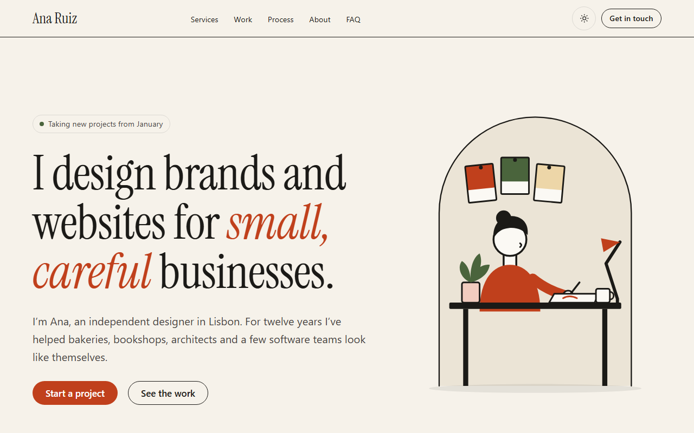

# Alcor

A free one-page Jekyll theme for freelancers and small studios. Warm paper, ink and one vermilion accent. It works on GitHub Pages with no build tools.

**[Live demo](https://alcor.tortoizthemes.com)** · MIT licence · by [Tortoiz Themes](https://tortoizthemes.com)



## What you get

- **One page, built from sections.** Hero, client names, services, work, process, about, testimonials, FAQ and contact. Reorder them, switch them off or use one twice, all in one file.
- **Works on GitHub Pages.** No GitHub Actions and no custom plugins: only `jekyll-seo-tag`, `jekyll-sitemap` and `jekyll-remote-theme`, which GitHub Pages already runs.
- **Fast.** No jQuery, no Bootstrap, no icon font. One small font, all CSS inside the page, and under 1 KB of JavaScript. Built for 100 on mobile PageSpeed.
- **Light and dark mode.** It follows the visitor's setting, with a switch that remembers their choice.
- **Accessible.** Every colour pair passes WCAG AA in both modes. Skip link, focus styles, real headings.
- **A contact form that needs no JavaScript.** Works with [Web3Forms](https://web3forms.com) or [Formspree](https://formspree.io).
- **Illustrations that recolour themselves.** Six drawings come with the theme. They follow your colours and dark mode, and you can use them anywhere under the MIT licence.
- **Search-ready.** Page titles, descriptions, social image, sitemap, and structured data about you and your FAQ.

## Quick start

### 1. Use this template (easiest)

1. Click **Use this template** at the top of this page, then **Create a new repository**.
2. Name it `your-username.github.io` for a personal site, or anything you like for a project site.
3. In the new repository, open **Settings → Pages**. Under **Build and deployment**, pick **Deploy from a branch**, then `main` and `/ (root)`.
4. Edit `_config.yml` (your name, email, links) and `index.md` (your words). Your site is live at `https://your-username.github.io` within a minute or two.

For a project site (`your-username.github.io/my-site`), set `baseurl: "/my-site"` in `_config.yml`.

### 2. Add it to a site you already have (remote theme)

In your `_config.yml`:

```yaml
remote_theme: Tortoiz-Themes/alcor-jekyll
plugins:
  - jekyll-remote-theme
  - jekyll-seo-tag
  - jekyll-sitemap
```

Then copy `index.md`, `thank-you.html` and `404.html` from this repository into your site, and copy the `alcor:` block from this `_config.yml` into yours. (Jekyll doesn't read a remote theme's own settings, so they have to live in your site.)

### 3. As a gem (local builds, Netlify, Cloudflare Pages)

In your `Gemfile`:

```ruby
gem "jekyll-theme-alcor", git: "https://github.com/Tortoiz-Themes/alcor-jekyll"
```

In `_config.yml`, set `theme: jekyll-theme-alcor`, then copy the same three pages and the `alcor:` block as above.

## Edit your page

Everything on the home page lives in the front matter of `index.md`, under `sections:`. Each item is one section:

```yaml
sections:
  - type: hero
    heading: I design brands and websites for *small, careful* businesses.
    text: I'm Ana, an independent designer in Lisbon.
    actions:
      - label: Start a project
        url: "#contact"
  - type: services
    label: Services        # the small numbered label above the heading
    nav: Services          # adds a link to the header menu
    heading: What I can help with
    items:
      - title: Brand identity
        text: Name, logo, colours and type.
        price: From €2,400
```

- Section labels are numbered for you ("01 — Services"), so reordering renumbers them.
- Add `hidden: true` to switch a section off without deleting it.
- Add `tone: sand`, `tone: ink` or `tone: vermilion` to give a section a different background.
- Put `*stars*` around words in a heading to set them in vermilion italics.

| Section | Variants | Notes |
|---|---|---|
| `hero` | `text`, `portrait` | Big statement, availability badge, buttons, optional facts row. `portrait` adds a photo or drawing beside it. |
| `logos` | – | Client names in the display font, or logo images. |
| `services` | `list`, `cards` | Numbered rows like a printed menu, or cards. Optional prices and tags. |
| `work` | `cards`, `list` | Project cards with a photo, a drawing or a coloured panel; or a compact index by year. |
| `process` | – | Three to five numbered steps. |
| `about` | – | A photo or drawing beside a few paragraphs, with facts and a CV link. |
| `testimonials` | `single`, `grid` | One large quote, or two or three side by side. |
| `faq` | – | Questions that open without JavaScript. Also tells search engines about them. |
| `contact` | – | Form, email, "book a call" link and your profiles. |

Every section's fields are listed in a comment at the top of its file in `_includes/sections/`.

## Settings

The things that appear in more than one place go under `alcor:` in `_config.yml`:

```yaml
alcor:
  name: Ana Ruiz
  role: Brand and web designer
  location: Lisbon, Portugal
  email: hello@example.com
  availability:
    state: available            # available | booked | closed
    text: Taking new projects from January
  header_action:                # set to false to hide the header button
    label: Get in touch
    url: "#contact"
  social:
    - label: LinkedIn
      url: https://www.linkedin.com/in/you
      handle: in/you
  form:
    provider: web3forms         # web3forms | formspree | demo
    access_key: your-key        # for Web3Forms
    # endpoint: https://formspree.io/f/your-id   # for Formspree
  footer:
    text: Good work, *quietly* done.
  credit: true
```

## The contact form

The form posts straight to a form service, so it needs no JavaScript and no server of your own.

- **Web3Forms:** get a free access key at [web3forms.com](https://web3forms.com), then set `provider: web3forms` and `access_key`. Messages arrive in your inbox, and visitors land on your thank-you page.
- **Formspree:** create a form at [formspree.io](https://formspree.io), then set `provider: formspree` and `endpoint`.
- **demo:** sends nothing and goes straight to the thank-you page. The demo site uses it.

Both services get a hidden spam-trap field.

## Pictures and illustrations

- **Photos:** put them in `assets/images/` and add `image: { src, alt, width, height }` to a hero, about or work item. WebP at about twice the shown size keeps the page fast ([Squoosh](https://squoosh.app) is a good free tool for this).
- **Drawings:** use `art: designer-desk` (or `studio-press`) (and `art_label:` to describe it) instead of `image:`. The drawings live in `_includes/art/`. They use colour classes, not fixed colours, so they follow your palette and dark mode. Add your own SVG there in the same way.

## Colours and fonts

- Colours live in `_includes/css/theme.css` as plain CSS, with a light and a dark value for each. Change `--brand` to re-colour links, buttons and the accent words.
- Headings use Instrument Serif (self-hosted, about 21 KB). Body text uses each visitor's system font.
- The CSS is plain CSS, not Sass, because GitHub Pages still runs an old Sass that can't read modern CSS.

## The footer credit

The footer says "Theme by Tortoiz Themes" with a link. It's how other people find this free theme, so we'd be grateful if you keep it. To remove it, set `credit: false` under `alcor:`.

## Need more pages?

Alcor is one page on purpose. If you need a blog, project pages, a shop or many page layouts, take a look at our premium Jekyll themes:

- [Snowlake](https://tortoizthemes.com/products/snowlake/): multipurpose, with ready-made blocks for agencies, studios and startups
- [Sandbox](https://tortoizthemes.com/products/sandbox/): 30+ home pages and 100+ pages for businesses and portfolios
- [Dexfolio](https://tortoizthemes.com/products/dexfolio/): a creative agency theme with full portfolio pages

All Tortoiz themes: [tortoizthemes.com](https://tortoizthemes.com)

## Run it on your computer

You need Ruby and Bundler.

```bash
bundle install
bundle exec jekyll serve
```

Then open http://localhost:4000. The `Gemfile` uses the same versions GitHub Pages runs (Jekyll 3.10), so what you see locally is what goes live.

## Licence

MIT, for the code and the illustrations. The Instrument Serif font is under the SIL Open Font License. See [LICENSE](LICENSE).
